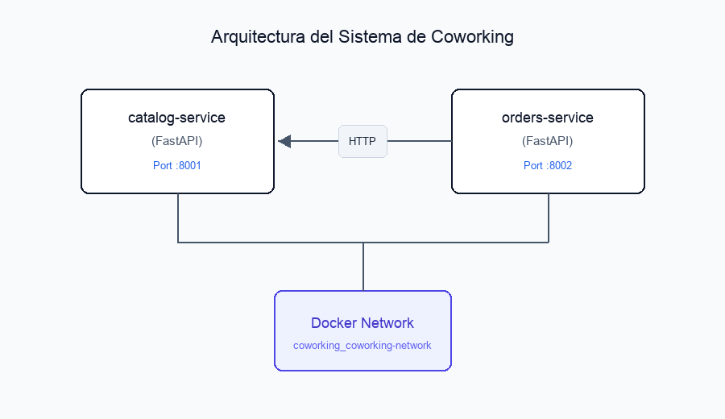

# Coworking Workshop: Microservicios & Chaos Engineering

Taller práctico de diseño, orquestación y pruebas de resiliencia con **FastAPI**, **Docker Compose** y **Chaos Engineering**.

---

## 🏛️ Arquitectura del Sistema

El sistema está compuesto por dos microservicios que interactúan mediante HTTP síncrono sobre una red privada virtual de Docker (`coworking_coworking-network`):

```
+--------------------+        +------------------+
|   catalog-service  |<-------|  orders-service  |
|      (FastAPI)     |  HTTP  |     (FastAPI)    |
|        :8001       |        |       :8002      |
+--------------------+        +------------------+
          |                             |
          +--------------+--------------+
                         |
                 +---------------+
                 | Docker Network|
                 +---------------+
```



### Servicios:
1. **`catalog-service` (Puerto 8001)**:
   - Expone los espacios de coworking disponibles (hot desks, oficinas privadas, salas de juntas).
   - Endpoints: `GET /health`, `GET /spaces`, `GET /spaces/{id}`.
2. **`orders-service` (Puerto 8002)**:
   - Orquesta la creación y consulta de reservas de espacios.
   - Consulta a `catalog-service` para verificar precios y existencia de espacios antes de confirmar órdenes.
   - Endpoints: `GET /health`, `POST /orders`, `GET /orders`, `GET /orders/{id}`.

---

## 📁 Estructura del Proyecto

```text
coworking-workshop/
├── README.md                           # Guía completa del workshop
├── docker-compose.yml                  # Orquestación con red compartida
├── chaos-test.sh                       # Script automatizado de Chaos Engineering (LAB 4)
├── chaos-report.md                     # Informe técnico de fallas e impacto
├── architecture-diagram.png            # Diagrama visual de la arquitectura
├── coworking.postman_collection.json   # Colección Postman para pruebas
├── catalog-service/
│   ├── main.py                         # Código del servicio de catálogo
│   ├── requirements.txt                # Dependencias Python
│   └── Dockerfile                      # Imagen Docker
└── orders-service/
    ├── main.py                         # Código del servicio de órdenes
    ├── requirements.txt                # Dependencias Python (incluye httpx)
    └── Dockerfile                      # Imagen Docker
```

---

## 🚀 Guía de Laboratorios

### LAB 1: catalog-service con FastAPI
**Objetivo**: Crear un servicio que exponga espacios de coworking vía HTTP.

#### Prueba local:
```bash
cd catalog-service
pip install -r requirements.txt
python main.py
```

En otra terminal, probar endpoints:
```bash
# Verificar estado
curl http://localhost:8001/health

# Listar espacios
curl http://localhost:8001/spaces

# Consultar espacio específico
curl http://localhost:8001/spaces/1
```

---

### LAB 2: orders-service que consulta al catálogo
**Objetivo**: Crear un servicio que dependa del `catalog-service` vía HTTP.

#### Prueba local:
```bash
cd orders-service
pip install -r requirements.txt
python main.py
```

Prueba de endpoint de salud:
```bash
curl http://localhost:8002/health
```

---

### LAB 3: Docker Compose con red compartida
**Objetivo**: Orquestar ambos servicios con networking interno y resolución de nombres DNS.

#### Levantar el entorno:
```bash
# Construir imágenes y levantar contenedores en segundo plano
docker-compose up --build -d
```

#### Probar el flujo completo:
```bash
# 1. Ver espacios disponibles en el catálogo
curl http://localhost:8001/spaces

# 2. Crear una orden (orders-service consulta internamente a catalog-service)
curl -X POST "http://localhost:8002/orders?space_id=1&user_email=test@example.com&hours=2"

# 3. Ver órdenes creadas
curl http://localhost:8002/orders
```

---

### LAB 4: Chaos Engineering - Apagar el catálogo
**Objetivo**: Experimentar fallos reales de sistemas distribuidos y observar la tolerancia a fallos.

#### Ejecutar script automatizado:
```bash
chmod +x chaos-test.sh
./chaos-test.sh
```

#### Observaciones esperadas:
1. **Primera petición**: Éxito (`200 OK`) con orden registrada.
2. **Con catálogo caído**: Error `503 Service Unavailable` con mensaje `"Catalog service unavailable"`.
3. **Después de recuperación**: Éxito (`200 OK`) automático al reiniciar el catálogo.

---

### LAB 5: Chaos Engineering - Cambiar el contrato sin avisar
**Objetivo**: Simular y diagnosticar una rotura de integración debida a un cambio de contrato sin versionar (*breaking change*).

#### Paso 1: Modificar `catalog-service` (romper contrato)
Editar [catalog-service/main.py](file:///Users/faridzemanate/Docs/proyecsab/catalog-service/main.py) y cambiar `price_per_hour` por `hourly_rate`:

```python
# En la clase Space y en el diccionario SPACES_DB:
# Cambiar:
# "price_per_hour": 15.0
# Por:
# "hourly_rate": 15.0
```

#### Paso 2: Reconstruir y probar
```bash
# Reconstruir el servicio con el cambio
docker-compose up --build -d catalog-service

# Esperar unos segundos a que esté listo
sleep 5

# Intentar crear una orden (fallará por cambio de contrato)
curl -X POST "http://localhost:8002/orders?space_id=1&user_email=contract@test.com&hours=2"
```

**Resultado esperado**:
Error `500 Internal Server Error` o `KeyError` debido a que `orders-service` espera `space["price_per_hour"]` pero el catálogo ahora retorna `hourly_rate`.

#### Paso 3: Documentar y analizar
Revisar el informe detallado en [chaos-report.md](file:///Users/faridzemanate/Docs/proyecsab/chaos-report.md) para ver la causa raíz y las soluciones propuestas (versionamiento de APIs, pruebas de contrato con Pact, y campos retrocompatibles).

---

## 🛠️ Comandos de Debugging Útiles

```bash
# Ver logs en tiempo real
docker-compose logs -f

# Ver estado de servicios
docker-compose ps

# Entrar a la terminal de un contenedor
docker-compose exec orders-service bash

# Listar redes Docker
docker network ls

# Inspeccionar la red compartida del taller
docker network inspect coworking_coworking-network

# Probar conectividad DNS y red entre contenedores
docker-compose exec orders-service ping catalog-service

# Reconstruir imágenes sin caché
docker-compose build --no-cache

# Detener todos los servicios y remover volúmenes/redes
docker-compose down
```

---

## 📮 Pruebas con Postman
Importar el archivo [coworking.postman_collection.json](file:///Users/faridzemanate/Docs/proyecsab/coworking.postman_collection.json) directamente en Postman para interactuar con todos los endpoints preconfigurados.
